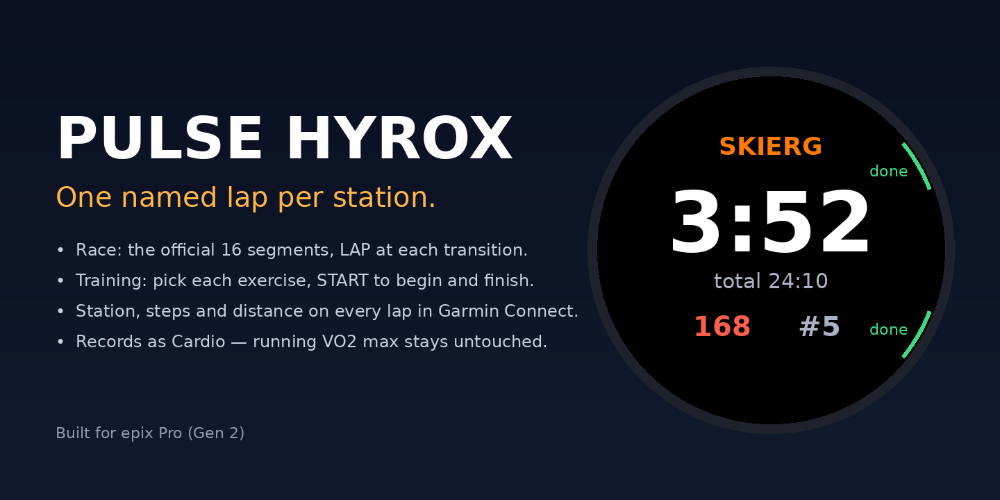

# Pulse HYROX

A Connect IQ activity app for Garmin watches that records a **HYROX** race or training session as one Cardio activity with **one named lap per run / station** — so Garmin Connect, Strava and anything that reads the FIT file get per-station times, heart rate and distance.



- **Race mode** — the official 16 segments in order (Run 1, SkiErg, Run 2, Sled push, Run 3, Sled pull, Run 4, Burpee broad jumps, Run 5, Row, Run 6, Farmers carry, Run 7, Sandbag lunges, Run 8, Wall balls). START to begin, LAP at each transition, START to save after the last one.
- **Training mode** — build the session as you go: pick each exercise from a list (SkiErg, Sled push, Sled pull, Burpee BJ, Row, Farmers, Lunges, Wall balls, Run, Rest), START to begin it, START or LAP to finish it and return to the list. Rest between exercises is timed; pick **Rest** to record it as its own lap.
- Heart rate coloured by your Garmin HR zones; step-based distance estimate on screen for farmers carry, lunges and runs.
- Saved as **"HYROX Training"** or **"HYROX Race"**. Records as **Cardio** (training load counts; running VO2 max and race predictions are untouched). Strava shows it as a Workout.
- Every lap carries FIT developer fields: `station` (name), `station_idx`, `steps`, `est_m` — visible per lap in Garmin Connect (Laps tab) only for sessions recorded with the store-installed app — a sideloaded build's columns are not shown.
- No settings, no account, no network: nothing leaves the watch. [Privacy policy](docs/privacy.html).

Built for 74 round Garmin watches (full list in `devices.txt`):
- **fēnix / epix** — fēnix 5 Plus series, 6, 7, 8 (AMOLED + Solar), epix 2 / epix Pro, Enduro, Enduro 3, MARQ 2, D2 Mach 1, Descent Mk2 / Mk3
- **Forerunner** — 165, 245, 255, 265, 570, 745, 945, 955, 965, 970
- **Instinct** — 2 / 2S / 2X, Crossover (+ AMOLED), 3 (AMOLED + Solar), E
- **Venu / vívoactive** — Venu, Venu 2 / 2S / 2 Plus, Venu 3 / 3S, Venu 4, vívoactive 4 / 4S / 5 / 6

Tested on hardware: epix Pro (Gen 2) 47 mm. The layout adapts per watch: each text row takes the largest font that fits the round screen at that height and stays clear of the button hints; 1-bit screens (Instinct) draw white-only and show live heart rate in the sub-screen; watches without UP/DOWN buttons (Venu, vívoactive) choose with vertical swipes and a tap acts as START on the start and pick screens. Sideways swipes are ignored and taps never end a lap, so a wet wrist can't split a station.

## Controls
| Screen | START | LAP (BACK) | UP / DOWN |
|---|---|---|---|
| Start | go (race) / pick (training) | exit | race ↔ training |
| Race segment | pause / resume | next segment (16th → finish) | — |
| Training list | begin highlighted exercise | Resume / Save / Discard menu | choose |
| Training exercise | done → list | done → list | — |
| Paused | resume | menu | — |

Button help is drawn as coloured arcs beside the physical buttons (green = START action, orange = LAP menu, grey = UP/DOWN), which keeps the round screen's bottom edge clear. Screens under 200 px (Instinct) show the arcs without words.

On **Venu / vívoactive** (two buttons + touch): top button = START, bottom button = LAP / BACK, swipe up / down = DOWN / UP, tap = START on the start and pick screens only.

## Install
- **Connect IQ Store**: search "Pulse HYROX" in the Connect IQ app on your phone ([apps.garmin.com](https://apps.garmin.com), published by "Pulse").
- **Sideload**: build or download `PulseHyrox.prg`, connect the watch by USB and copy it into `GARMIN/Apps/`. On Linux the epix mounts over MTP: wait for `mtp:host=091e_…` under `/run/user/<uid>/gvfs/`, then `gio copy PulseHyrox.prg "mtp://<host>/Internal Storage/GARMIN/Apps/PulseHyrox.prg"` (plain `cp` fails on MTP). If `lsusb` shows `091e:0003` with nothing mountable, the watch is still in Garmin mode — it switches to MTP on its own after a few seconds; repeated `error -71` in `dmesg` means the cable or the contacts.

## Build
Needs the Connect IQ SDK (any 7+; built with 9.3), the device definition(s) from Garmin's SDK Manager (or [connect-iq-sdk-manager-cli](https://github.com/lindell/connect-iq-sdk-manager-cli) on a headless machine: `connect-iq-sdk-manager login --username …` then `device download --device epix2pro47mm`), and a developer key (`openssl genrsa -out dev.pem 4096 && openssl pkcs8 -topk8 -inform PEM -outform DER -in dev.pem -out dev.der -nocrypt`).

With Visual Studio Code + the Monkey C extension: open the folder, *Monkey C: Build for Device* / *Export Project*.

Without the SDK on the host, `build.sh` runs the compiler in a stock Java container:

```sh
SDK=~/connectiq-sdk-lin-9.3.0 KEY=~/dev.der ./build.sh epix2pro47mm   # sideload build → bin/PulseHyrox.prg
SDK=~/connectiq-sdk-lin-9.3.0 KEY=~/dev.der ./build.sh                # store package  → bin/PulseHyrox.iq
```

### Devices
`devices.txt` is the wanted list. After downloading definitions (`for d in $(grep -v '^#' devices.txt); do connect-iq-sdk-manager device download --device $d; done`), run

```sh
python3 tools/devices.py ~/.Garmin/ConnectIQ/Devices    # writes manifest.xml products + monkey.jungle mono lines
python3 tools/preview.py ~/.Garmin/ConnectIQ/Devices /tmp/preview   # approximate screens per watch + clipping check (needs Pillow)
```

`devices.py` keeps the ids that have a definition, a round (or Instinct semi-octagon) screen and Connect IQ ≥ 3.2, and lists 1-bit screens in `monkey.jungle` so they compile the `(:mono)` drawing helpers. The compiler rejects jungle lines for ids it has no definition for, which is why those lines are generated rather than committed by hand. `preview.py` only approximates the system fonts — confirm in the SDK simulator before trusting a new screen size.

## FIT fields
| Field | id | type | meaning |
|---|---|---|---|
| `station` | 0 | string(12) | exercise name ("SkiErg", "Run 3", "Rest" …) |
| `station_idx` | 1 | uint8 | race: 0–15 segment index; training: 100 + list index (109 = Rest) |
| `steps` | 2 | uint16 | watch pedometer delta during the lap |
| `est_m` | 3 | uint16 | steps × stride (farmers 0.65 m, lunges 0.75 m, run 1.1 m); 0 when not estimated |

Implementation note: `Field.setData()` only stages the value for the *next* lap write, so the app re-applies all four fields on every 250 ms tick; a lap written with stale fields was the first bug on hardware. `resources/fitcontributions/fitcontributions.xml` declares the fields so Garmin Connect displays them (store builds only).

## Store listing
`store/` holds the cover, icons, the four 416 × 416 screen images and `listing.md` with the description (English + Arabic) and the answers to the upload form.

## Licence
MIT. Built for [Pulse](https://github.com/ammarhussein5481-hash/pulse), a personal training dashboard, but the app has no dependency on it.
